

  

# LiteModelProcess·AI工业模型处理与设备展示平台

> 打开网页就能处理工业三维模型，也能把同一份模型做成客户看得懂的设备展示。上传 STEP 即得轻量化 GLB，**千万级三角面大装配浏览器流畅渲染**，右键菜单完成减面、修孔、改轴心等专业编辑；再用整机导览、部件聚焦、内部透视、热点与说明卡把产品结构讲清楚，支持 AI 按大纲生成导览与本地离线语音讲解。离线包私有化交付，支持国产化系统，模型数据不出内网。

LiteModelProcess·AI 是**面向设备厂商与工业模型团队的网页式模型处理与设备展示平台**，在同一套网页工作台里集中完成两条主线的工作：

- **工业模型处理与轻量化**：把 STEP/STP、STL、PLY、OBJ、GLB、IFC 等工业模型转换为浏览器可直接交互的标准 GLB，并在网页中完成减面、节点合并、孔洞修复、轴心调整、遮挡剔除等轻量化编辑，导出结果可直接集成到 Three.js、Unity、Unreal Engine；
- **设备产品展示与交互讲解**：把处理好的模型制作成客户能自主浏览的设备介绍——整机概览、关键部件、内部结构按顺序讲解，配合镜头聚焦、背景半透明、卡片、热点与讲解语音，制成部署网络内可打开的只读展示链接，用于销售介绍、展台播放、方案评审与培训。

产品以**离线包**形式私有化交付，部署在企业自己的服务器上（可完全在内网），模型数据不出本地。

> **两条交付路径**：工程团队获得 GLB 等标准资产；销售与客户获得可在部署网络内打开的交互展示链接。两条路径可同时使用，不需要为产品展示另做一套模型。

  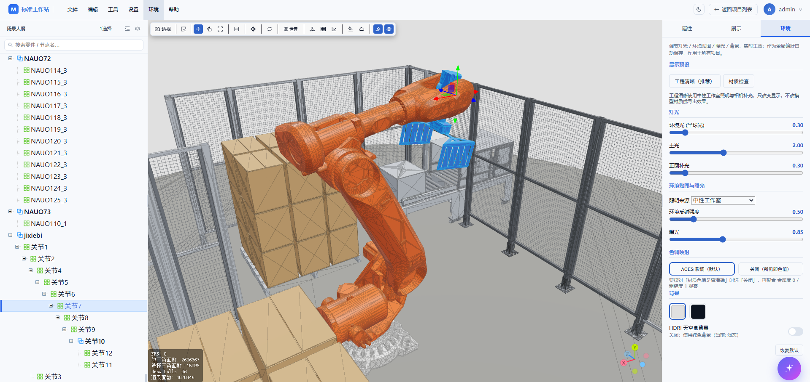
   
  网页式工作台全貌：左侧装配树、中间大装配三维视口（边面模式）、右侧属性与材质面板，顶部为文件 / 编辑 / 工具等菜单（图为码垛工作站案例）

## 四个购买理由

| 购买理由 | 我们提供的能力 | 使用后的直接价值 |
| --- | --- | --- |
| **① 模型处理：让设计模型进入业务系统** | 从导入、层级整理到修复、减面、材质和导出，在一个工作台完成；对含可解析 PMI 的 STEP 保留零件尺寸、公差与基准 | 工程团队交付的是整理后的标准模型资产，而不是让下游继续接力处理的原始大文件 |
| **② 设备展示：让产品结构成为销售内容** | 同一份模型制作成整机介绍、部件讲解与内部透视；导览连续介绍，热点供客户主动探索，说明卡与可选语音承接产品知识 | 用于销售介绍、展厅播放、方案评审与培训，不必分别维护多套模型 |
| **③ 网页使用：减少安装与重复制作** | 打开兼容浏览器即可处理模型和制作展示，接收方通过发布链接查看；AI 可按大纲生成可编辑导览，本地语音生成后可试听采用 | 员工不必为平台已覆盖的流程另装专业桌面软件，客户打开链接就能看 |
| **④ 私有化与国产化适配：把能力部署在企业环境中** | Windows 与 Linux Docker 交付路径，支持内网部署、离线授权与转换节点扩展；国产化适配面向 x86_64 Linux 环境 | 在企业可控的网络和存储中管理模型与展示成果，减少业务与单一桌面系统的绑定 |

> **国产操作系统适配不等于全栈国产或所有国产 CPU 已兼容。** 当前交付目标为 Windows x64 与 Linux x86_64；ARM、龙芯等其他架构及信创认证**不作为现有版本的默认承诺**，须在客户目标系统验证后部署。

## 适用场景

- **数字孪生与三维展示** —— 机械装备、产线与工艺设备的 Web 三维展示，替代"截图贴 PPT"式的静态交付；
- **设计评审与装配仿真** —— 大装配在浏览器里直接转着看、量着改，设计、工艺、质量多岗位**免装 CAD** 即可参与评审；
- **维修手册与备件图册** —— 三维交互式交付，拆装顺序、备件位置一目了然，替代厚重纸质图册与静态截图；
- **教学实训与虚拟展厅** —— 无需工作站机房，普通电脑的浏览器即可开展三维教学、实训与在线展厅；
- **内网 / 信创环境轻量化** —— 大模型私有化轻量化与在线预览，数据不出内网，适配信创办公与国产化服务器。

## 下载（离线包）

> 最新版本 **v1.0.0** 已发布 —— [Release 发布页](https://github.com/starTechnology1994/LiteModel-AI/releases) · [版本记录](https://github.com/starTechnology1994/LiteModel-AI/releases/tag/v1.0.0)

平台以离线包形式交付，部署即用（配置要求见 [部署要求](#部署要求一台服务器带-10-人同时使用)）：

- **Windows 离线包**（免装环境，解压启动）→ [下载 LiteModelProcess-Windows.zip](https://github.com/starTechnology1994/LiteModel-AI/releases/download/v1.0.0/LiteModelProcess-Windows.zip)
- **Linux 离线包**（Docker 离线镜像，支持完全断网与国产化系统）→ [下载 LiteModelProcess-Linux.tar.gz](https://github.com/starTechnology1994/LiteModel-AI/releases/download/v1.0.0/LiteModelProcess-Linux.tar.gz)

> 仓库与 Release 尚未创建，上述直链为预留地址，上传离线包后即为有效下载链接。

## 主流工业软件兼容性

平台支持的 STEP 与 STL 正是工业界的通用交换格式，**主流 CAD 软件无需安装任何插件、直接"另存为"即可导出**：

| 软件 | 导出 STEP/STP | 导出 STL | 说明 |
| --- | --- | --- | --- |
| Siemens NX（UG） | ✅ AP203/214/242 | ✅ | 另支持 Parasolid / IGES / JT |
| SolidWorks | ✅ | ✅ | 另支持 3MF / AMF / Parasolid |
| CATIA（V5 / 3DEXPERIENCE） | ✅ | ✅ | 达索体系标准交换格式 |
| Creo（Pro/E） | ✅ | ✅ | PTC 体系 |
| Inventor | ✅ | ✅ | Autodesk 体系 |
| Fusion 360 | ✅ | ✅ | |
| Solid Edge | ✅ | ✅ | |
| Rhino | ✅ | ✅ | |
| 中望3D / CAXA（国产） | ✅ | ✅ | 信创环境常用 |
| FreeCAD / Onshape | ✅ | ✅ | |

> STEP 是 ISO 工业交换标准（AP203 / AP214 / AP242），被称为 CAD 领域的"通用语言"；STL 是 3D 打印标配的三角网格格式。**建议优先提供 STEP/STP**：几何为精确曲面表达，平台按目标精度统一网格化，轻量化效果最佳；STL 进入平台时精度已由导出方定格。

---

## 工业模型处理与轻量化

### 纯网页处理，无需安装任何软件

这是 LiteModelProcess·AI 与传统工具最大的区别：

- 打开浏览器即可完成**上传 → 转换 → 轻量化编辑 → 预览 → 导出**全流程，工作站上不再需要安装任何 CAD / DCC 软件；
- 重型计算（格式转换、减面、修孔）全部在服务器 CPU 上完成，客户电脑只负责浏览器渲染，普通办公电脑即可处理大型装配；
- 每位用户在各自浏览器中独立操作，多人同时使用互不干扰；
- 修改即所见：所有编辑实时反映在三维视口中，全程无需"导出再看"。

  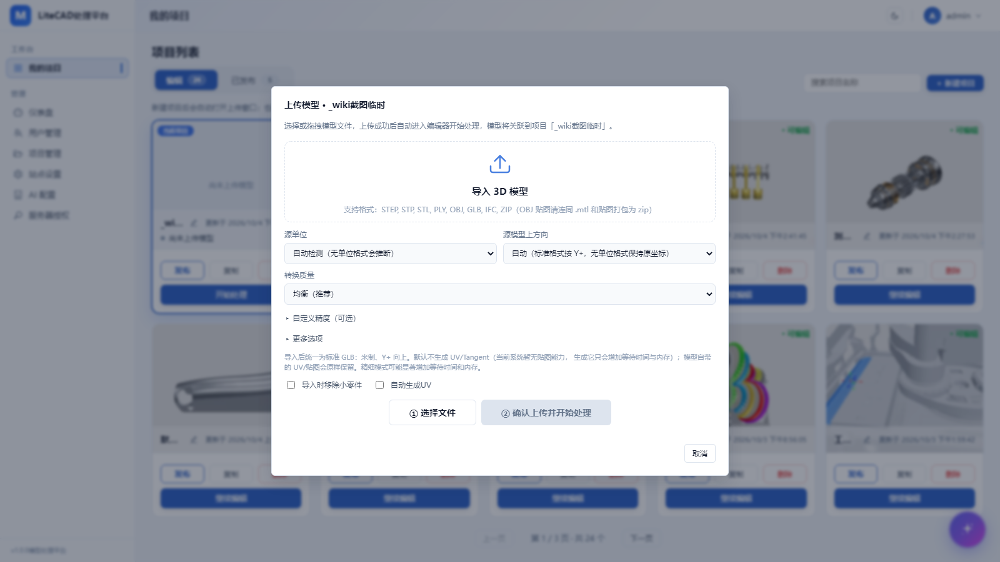
   
  新建项目后自动打开上传窗口：选择 STEP/STP、STL、PLY、OBJ、GLB、IFC、ZIP，并设置源单位、上方向与 fast / balanced / fine 三档转换质量

### 千万级三角面工业模型高性能渲染（核心竞争力）

针对工业 CAD 大装配的渲染瓶颈做了底层优化，**千万级面模型也能在浏览器中正确、流畅地渲染**：

- **唯一几何批处理渲染**：重复零件自动共享几何体，上万零件合并为极少量 Draw Call（实测 540 万三角面 / 17,026 个几何体的大型装配合并为 1 个 Draw Call），交互始终流畅；
- **BVH 加速拾取**：基于层次包围盒的空间索引，千万级三角面模型上点选、框选依然即时响应；
- **按对象视锥裁剪**：视野外的零件不参与渲染，转动视角不掉帧；
- **按需构建着色资源**：线框等模式在首次使用时才生成，不预先占用显存；
- **资源全生命周期释放**：切换模型、关闭页面即时释放几何体、纹理、环境贴图与 WebGL 上下文，长时间使用不累积内存；
- **大模型秒级恢复**：转换结果缓存 + 场景持久化，同一模型再次打开秒级载入。

> 性能数字取自产品开发过程记录，属非正式验收口径，对外引用须说明样本、版本、内核与配置。

### 专业级场景树与右键菜单

完整装配树管理，**右键菜单集中了全部专业编辑能力**，所有操作均支持撤销 / 重做：

| 右键菜单项    | 功能说明                                          |
| -------- | --------------------------------------------- |
| 仅编辑此模型   | 临时隔离显示选中的零件 / 组件，其余全部隐藏，专心处理单个对象；再次点击退出隔离     |
| 选择所有后代零件 | 对文件夹类节点一键递归选中其下全部零件，方便批量减面、批量删除               |
| 重命名      | 就地重命名零件与组件                                    |
| 压缩树      | 折叠压缩中间空层级，精简深层装配树结构                           |
| 减面       | 网格抽稀减面，可调比率与线程数，可选严格保护开口与外边界                  |
| 孔洞处理     | 一键坍缩网格孔洞                                      |
| 修复破损面    | 自动修复破损、退化面片                                   |
| 修改轴心     | 三种轴心预设子菜单：**中心位置 / 底部位置 / 世界原点**，解决导入模型轴心错乱问题 |
| 重置变换     | 一键归零选中节点的位置、旋转、缩放                             |
| 合并选中项    | 把多个选中零件合并为单一网格，简化场景结构                         |
| 删除       | 批量删除选中节点                                      |

场景树还支持：**多选**（视口点选 / 框选与树双向联动）、**搜索定位**（命中关键词高亮并自动展开滚动到节点）、**拖拽调整层级**（上沿插入 / 中间移入 / 下沿插入三种放置方式，带防呆校验与智能边缘滚动，数千节点大树上拖拽依然跟手）。

  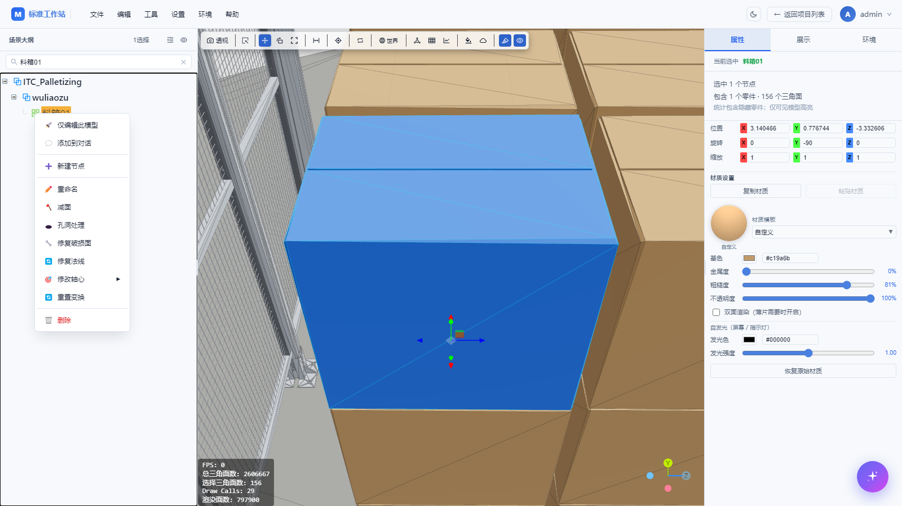
   
  在装配树零件上右键，即可呼出全部专业编辑：隔离编辑、批量选择后代、减面、孔洞处理、修复破损面、修复法线、修改轴心（中心 / 底部 / 世界原点）、重置变换与删除，右侧同步显示属性与材质

### 环境与材质管理

内置专业检查环境，不同岗位一键切换：

- **两套环境预设**：「工程清晰」（默认，高对比度看清结构）与「材质检查」（HDRI 环境光，真实反映材质质感）一键切换；
- **灯光精细可调**：棚拍布光 / HDRI 两种灯光模式，半球环境光、主光、正面补光、环境反射强度与曝光独立调节；
- **背景与天空盒**：浅色 / 深色背景切换、天空盒开关；
- **CAD 检查材质**：导入模型色彩自动标准化，无论装配多大、视角多远，零件始终清晰可辨；
- **特征边显示**：按二面角阈值（默认 30°）勾勒结构轮廓线，工程图级别的辨识度。

  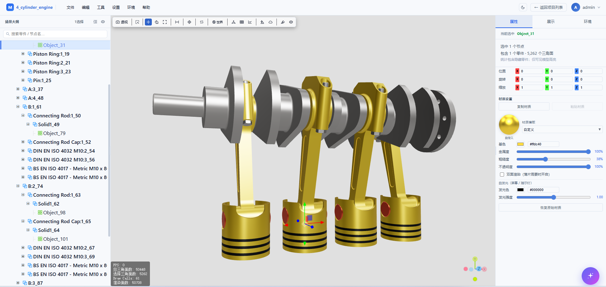
   
  右侧「属性」面板：上半部分是位置 / 旋转 / 缩放变换，下半部分是材质设置——材质球预览、材质模板、基色、金属度、粗糙度、不透明度、双面与自发光，支持复制 / 粘贴材质，修改实时生效并随项目保存

  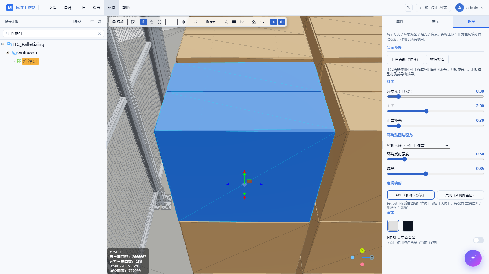
   
  右侧「环境」面板（全局偏好，不进导出文件）：工程清晰 / 材质检查两套显示预设，环境光、主光、补光、环境反射、曝光与色调映射可调，并可切换浅 / 深背景与 HDRI 天空盒

### 测量与检查工具

- **距离测量**：在模型上直接点选两点测距，测量结果以标签常驻显示，可随时清除；
- **属性面板**：查看节点名称、层级、几何信息，支持就地编辑；
- **多选与框选**：视口框选批量选中零件，配合右键菜单批量处理。

### 格式转换与轻量化

- STEP/STP、STL、PLY、OBJ、GLB 上传即转标准 GLB（米制、Y+ 向上、右手坐标）；
- fast / balanced / fine 三档网格化质量，默认档位按真实大型工业装配样本校准；
- 自动补齐 UV0 与 Tangent，重复网格自动实例化，显著压缩大装配体积与显存占用；
- 交付给浏览器的 GLB 自动做 Meshopt 体积压缩（部署后端 gltfpack 后生效，传输体积可再降 50–80%；编辑与导出使用的中间数据保持未压缩，不受影响）；
- 转换结果指纹缓存：相同源文件与参数再次上传，秒级恢复全部结果。

  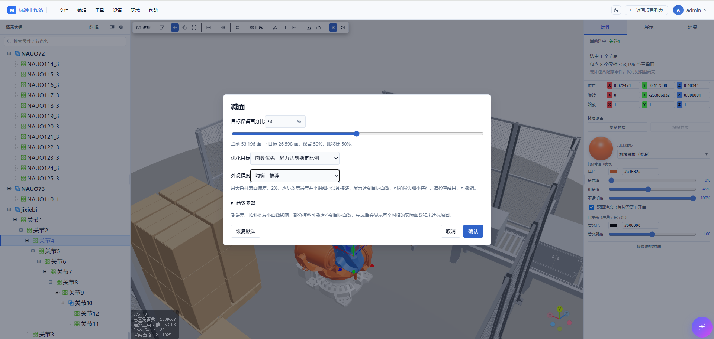
   
  右键零件选「减面」：拖动设置目标保留百分比（实时显示当前面数 → 目标面数），可选面数优先 / 外观优先、外观精度与表面偏差等高级参数，执行可撤销，可多轮逼近目标面数

**STEP 零件 PMI 读取与保留（工程信息随模型资产保留）**：PMI（产品与制造信息）包含尺寸、公差、基准等工程标注。**对带有可解析语义 PMI 的 STEP，当前 OCCT 导入路径读取与零件或子曲面关联的标注，并保存到对应零件。**

| 能力 | 当前实现与客户价值 |
| --- | --- |
| 零件级查看 | 在材质设置下方显示尺寸、形位公差、基准；无信息时隐藏，长列表内部滚动 |
| 轻量化后保留 | PMI 作为零件属性独立于三角网格面数保存，减面不会因面数变化而主动丢弃源标注；删除零件后不再交付其 PMI |
| 可追溯的工程属性 | 保存源标注类型、数值、单位及关联标签；长度与公差采用读取时的毫米单位，不随展示模型的米制缩放改写 |
| GLB 可选交付 | 导出勾选"携带 PMI 信息"后写入对应零件的自定义属性，供适配后的下游系统读取；**默认不勾选** |

> **信息与使用边界**：当前覆盖可解析且已关联的语义尺寸、形位公差与基准，**不承诺**所有 AP242 标注类型、完整公差修饰语或三维文字与引线重绘；不是每个 STEP 都含 PMI，没有标注的源文件不会自动生成工程信息。保留的是源 CAD 工程标注及源关联，**不能当作轻量化后三角网格的面编号**，也不作为制造、检验或认证依据。

### AI 全栈助手（对话式轻量化）

在网页对话框里用自然语言驱动轻量化全流程，AI 与三维视口实时联动：

- **场景体检**：一句"帮我看看当前场景"，AI 即输出结构化体检报告——总节点数、总三角面、最大尺寸、可压缩容器、可动单元与风险评级；
- **一键优化方案**：按标准工作流分步推进（清理空节点 → 清理小零件 → 减面到目标）。**当前该做哪一步由后端按场景实测数据确定性判定**，AI 只能从当前步开始、无法越级（不会一上来就去压缩层级或去重），每步生成方案卡片、确认后执行，全部操作可撤销；
- **目标面数减面**：直接说"帮我减到 50 万面"，AI 自动反推减面比例、定位重面节点、生成执行卡片，支持多轮迭代逼近；
- **节点级对话**：把场景树零件添加进对话框（与文字混排），AI 针对该零件 / 组件给出分析；
- **误伤拦截**：AI 对推荐参数二次校验，明显危险的建议（如小零件阈值会删掉大半模型）会被主动拒绝并说明原因；
- **多模型可配**：内置 DeepSeek / 通义千问 / Kimi / 智谱 / Claude / Gemini / OpenAI / Azure / Ollama / vLLM 等 11 种服务商预设，支持内网私有化大模型，对话与模型数据不出内网；
- **安全可控**：三种执行模式（建议 / 手动确认 / 全自动）、每用户调用限额、全量审计日志。

> AI 能力需接入大模型端点。内网 LLM（Ollama / vLLM）可保持对话不出域；配置云端端点时，提示与模型元数据可能发往该服务。AI 也可用于设备展示制作，见下文 [AI 按大纲生成标准导览](#ai-按大纲生成标准导览)。

### 多用户与任务队列

- 账号与项目隔离，管理员 / 普通用户双角色；
- 转换、减面、修孔、导出等重型任务共用**并行任务池**（独立子进程 / 多线程执行），并发路数随服务器内存配置 2–8 路，多人同时提交不用干等；真实进度可视、可取消，失败保留源文件可重试；
- **可横向扩展**：更高吞吐场景下可在内网加装多台转换节点，把最重的模型解析步骤外移横向扩展，加节点即加吞吐，前端与使用者零感知（详见[部署与运维（Wiki）](https://github.com/starTechnology1994/LiteModel-AI/wiki/部署与运维)）；
- 场景自动持久化，浏览器崩溃、服务重启后均可恢复。

> 10 人同时在线是初始容量规划目标，不是出厂人数限制或已验证的容量保证，需按客户模型与服务规格压测。横向扩容提升多任务吞吐，不代表单个任务等比例加速。

### 运行监控

- 健康检查与运行指标接口（`/healthz`、`/readyz`、`/api/runtime/metrics`）：进程 / 容器内存、常驻场景、磁盘占用一目了然，便于对接客户运维平台与告警。

### 私有化部署与国产化适配

- **Windows 离线包**解压启动，无需安装 Python / Node；
- **Linux Docker 离线包**加载镜像即用，支持**完全断网**环境；
- **国产化支持**：Linux 离线包支持在银河麒麟 V10、统信 UOS 等国产操作系统（x86\_64）上部署，适配信创内网环境；
- 亦可发布到客户私有镜像仓库交付；
- 授权采用离线机器码激活，全程不联网。

> 平台仍使用第三方开源组件（Docker 基础镜像为 Debian，FBX 导出另依赖 Autodesk FBX SDK）。"国产操作系统适配"描述的是目标环境部署能力，**不能等同于"全部组件国产"或"所有格式均无国外依赖"**。

---

## 设备展示与交互讲解

> **核心卖点**：在三维设备上直接讲清整机、部件与内部结构。自动**导览**服务连续介绍，**热点**服务客户主动提问，**卡片与讲解音频**提供可复用的内容。接收方只需浏览器，不必安装 CAD 或进入编辑工作台。

把已经处理好的模型制作成客户能自主浏览的设备介绍：以整机概览、关键部件、内部结构为讲解顺序，配合镜头聚焦、背景半透明、卡片、热点和语音，帮助客户理解产品构成。销售演示、展台自动播放、方案评审与培训可复用同一份展示配置。

### 发布与分享链接

1. 导入模型，整理层级、轴心、几何与材质，并确认保存；
2. 在展示面板配置导览、交互热点与卡片样式，通过实时预览检查并保存展示配置；
3. 发布项目：生成冻结快照并烘焙已保存的材质覆盖（后台任务显示读取、导出、压缩和写入进度）；
4. 发布成功后复制分享链接，接收方在**可访问服务的网络**中打开，免登录查看只读快照；
5. 模型修改后重新发布更新快照，通常沿用原链接；撤回后旧令牌的服务端访问失效，工作项目仍保留。

> "快速预览"指使用已处理 / 发布的轻量化资产查看模型，省去编辑工作台步骤；**不是首次 CAD 转换立即完成，也不是无需下载模型**。

### 导览、热点与卡片样式

| 配置区 | 用户配置什么 | 演示用途 |
| --- | --- | --- |
| **导览** | 多步骤、多有序动作，支持步骤折叠；配置自动 / 循环播放、常驻卡片、音乐与音效 | 按顺序介绍设备外观、部件与内部结构 |
| **热点** | 零件绑定的交互标记，配置编号、外观与多个有序动作 | 点击热点标记显示说明、聚焦或展示结构；点击模型仅选中 |
| **样式** | 可复用卡片的内容、外观、位置及媒体，选中或编辑时自动预览 | 所见即所得地编辑说明内容，供热点和导览共用 |

当前保留 **三种卡片样式**：

| 卡片样式 | 说明 |
| --- | --- |
| **引线卡片** | 由模型锚点引线连到说明卡，引线可选直线、正交折线或曲线；用"起点光点"控制线头标记 |
| **热点卡片** | 由热点标记唤起的卡片，"显示热点"默认开启，关闭只隐藏卡片自带的标记、保留卡片内容 |
| **图文浮层** | 图文浮层形式的说明内容，独立于引线 / 热点标记展示 |

正文与要点区分排版，可配置文字、图片、视频，并独立绑定讲解音频；**无网络环境使用本地托管媒体，不能依赖公网链接**。热点触发挂在同一零件上的卡片时，运行时自动隐藏重复的起点光点或卡片热点、共用一个标记；不改写保存的样式参数。

下面是这些配置在**编辑器右侧「展示」面板**里的真实样子（图为一台航空涡扇发动机的 AI 生成导览）：

  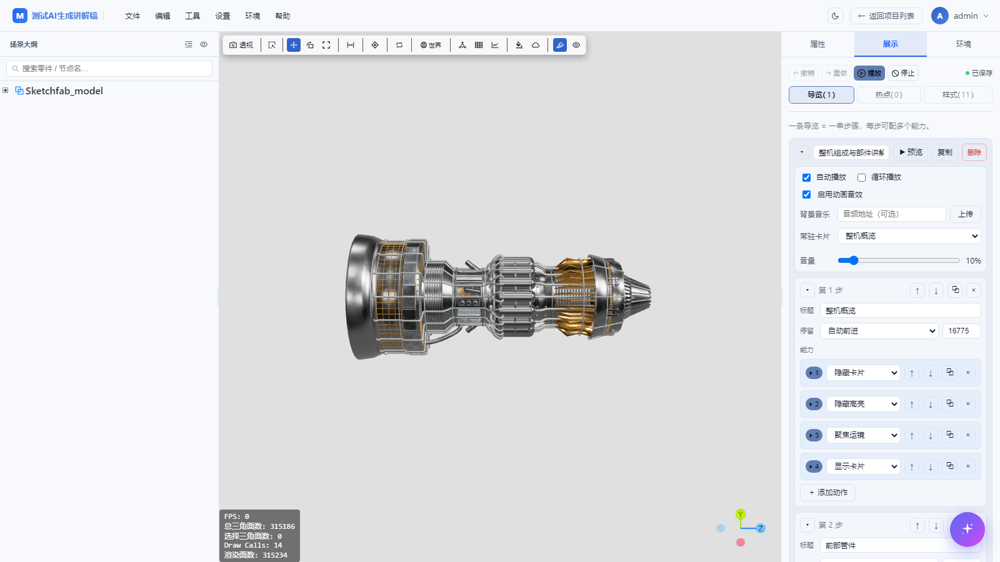
   
  「导览」分类：上半是导览级属性（自动播放、循环、动画音效、背景音乐、常驻卡片、音量），下方每个步骤配一组有序动作；顶部可随时跳转、重置、播放、停止试播

  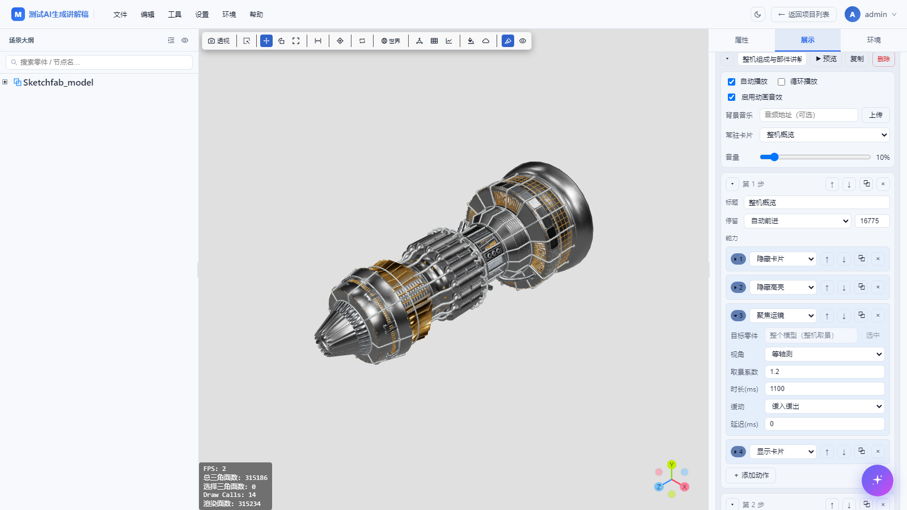
   
  展开某个动作即可按类型填参数——图示为「聚焦运镜」：目标零件、视角（等轴测）、取景系数、运镜时长、缓动曲线与延迟，视口同步预览取景效果

  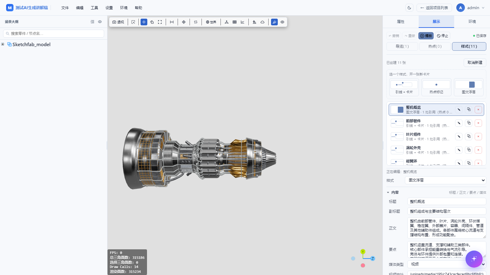
   
  「样式」分类点「＋ 新建卡片」弹出三种样式磁贴：引线＋卡片、热点标记、图文浮层；卡片内容、外观与媒体所见即所得编辑，供导览和热点共用（斜视视角）

  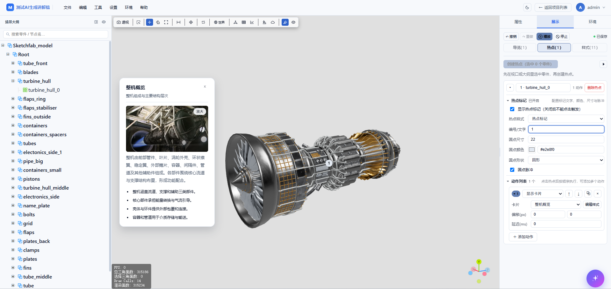
   
  「热点」分类：先在装配树或视口选中零件，再创建一个可点击的编号热点，为它配置编号、外观与一组有序动作；观众点热点标记才执行动作，点模型本体只做选中

### 标准部件讲解六动作

AI 标准模板的部件讲解动作固定为以下六步（手工导览可按需调整）：

| 顺序 | 动作 | 目的 |
| --- | --- | --- |
| 1 | 隐藏上一张步骤卡片 | 避免信息叠加，常驻概览由导览统一管理 |
| 2 | 隐藏上一段高亮 | 清除旧提示 |
| 3 | 全模型半透明 | 保留装配参照，降低背景干扰 |
| 4 | 当前部件及子节点恢复原材质 | 突出讲解对象而不改持久材质 |
| 5 | 聚焦运镜 | 将观众视线带到目标 |
| 6 | 显示当前卡片 | 展示正文、要点与可选讲解音频 |

### 常驻概览卡、背景音乐与入场音效

| 配置 | 当前能力 | 推荐用法 |
| --- | --- | --- |
| **常驻卡片** | 在步骤之外选择一张全局概览卡，不必每步重复添加显示动作 | 保留设备名称与总览信息，步骤卡介绍当前部件；常驻概览不在后续步骤重复讲解 |
| **背景音乐** | 导览级素材，默认循环，音量可调；普通手工配置默认 20%，AI 模板默认 10%；用户上传 / 填写地址后才播放 | 与步骤讲解独立配置 |
| **讲解音频** | 音频绑定卡片，可上传或本地生成 | 常驻概览只在首步讲解，后续不因常驻而反复触发概览配音 |
| **入场音效** | 系统内置轻扫等音效，支持试听与音量设置，导览可统一开关 | 用于引线生长 / 卡片出现，短提示音与讲解、音乐分开 |
| **播放控制** | 自动播放、循环播放、步骤停留与手动切换 | 展台可自动介绍，销售演示可人工控制关注点 |

背景音乐、讲解与入场提示音**三者独立配置**。

### AI 按大纲生成标准导览

用户输入"根据大纲生成设备展示导览"，系统按节点顺序形成整机概览、部件介绍与收尾。**默认最多 12 步，可配置 3–24 步**；超出预算的部件合并为明确目标集合，不随意改动装配结构。

- **标准动作固定**：隐藏卡片 → 隐藏高亮 → 全模型半透明 → 目标及子节点恢复原材质 → 聚焦运镜 → 显示卡片。AI 只生成受限文案，**不能随意改变目标节点或动作顺序**；
- **先试播，后保存**：推荐方案不直接写入项目；可试播观察镜头与卡片，通过确认才应用。应用后保留手工导览与热点，可继续编辑，也可**整体撤销 / 重做**；
- **配音由用户选择**：先明确选择仅文字或生成讲解音频，再选择男声 / 女声。自动流程分别使用中性男声 / 知性女声，默认 1.08 倍语速；
- **正文生成音频**：不朗读标题、副标题与要点，空正文跳过；逐张合成并上传，全部成功后一次应用；失败或取消不把半成品导览写入项目；
- **节奏与音效**：无配音默认每步 10 秒；有配音至少按音频长度加 1.8 秒设置停留；自动模板开启动画音效，背景音乐初始音量 10%；
- **文案可信边界**：按节点名称与有限摘要写稿，不上传网格；无语义名称只描述可观察结构，**不能凭外形保证设备功能**，正式使用前由业务人员核对。

### 离线语音讲解（本地 CPU 合成）

卡片"生成音频"打开居中弹窗，**只预填正文**（无正文时留空），用户修改讲解稿、选择音色与语速，生成后通过波形时间轴试听、调整音量与播放区间，再点"采用此音频"上传并替换当前卡片音频；不把草稿回写正文，不提前覆盖旧音频。

- **四个内置中文音色**：中性男声、沉稳男声、知性女声、清晰女声；
- **语速默认 1.08 倍，可调 0.8–2 倍**；单稿最多 2000 字，不提供未经模型支持的情绪 / 音高参数；
- 采用前只生成临时试听，取消不修改项目；修改稿件、音色或语速后需重新生成；
- **资源齐全时在本机 CPU 离线生成，不依赖公网 TTS 接口**；语音与 CAD 使用独立队列，当前语音 1 个执行、8 个排队，仍共享服务器 CPU，**不承诺多人同时立即出音频**；
- 专业术语与英文缩写需人工试听，建议用中文读法。**Windows 新包已捆绑语音资源，Linux 需单独配置目标平台环境**。

> AI 写稿与离线 TTS 是两个独立服务条件：导览文案需要大模型端点（内网部署需使用内网端点），语音合成则可在资源齐全后本地离线完成。

### 结构展示动作与独立爆炸

- **显示 / 隐藏 / 隔离模型**：选择父节点可作用于后代，不必逐一配置上万零件；
- **模型半透明**：设置临时不透明度或恢复原显示材质，用外壳半透明展示内部机构，区别于永久材质编辑；
- **恢复展示状态**：恢复模型显隐与半透明，**不重置独立爆炸工具，也不包含镜头、动画位姿、卡片、标注与高亮**，不等同于 Ctrl+Z；
- **独立爆炸工具**：通过查看工具按层级展开 / 收拢装配，可调层级与程度，**不属于热点或导览动作**；它展示装配关系，不提供机械运动学或碰撞求解。

> 显隐 / 半透明等动作是**临时展示效果**，不写回持久模型材质，也不加入模型编辑撤销栈；展示配置单独保存。

### 设备案例：一份可演示的真实运行画面

以下为现有项目"发动机引擎展示"的已发布页面截图（1600 × 900），9 步手工导览，包含整机、内部透视、进气、燃烧室、涡轮、管路、附件、紧固与铭牌。**以下是实际运行画面，不是概念效果图**；它保留原有高亮等手工动作，并不代表所有历史导览已改为新的 AI 六动作模板。案例文字用于展示方式说明，**设备原理与部件命名仍应由业务人员核对**。

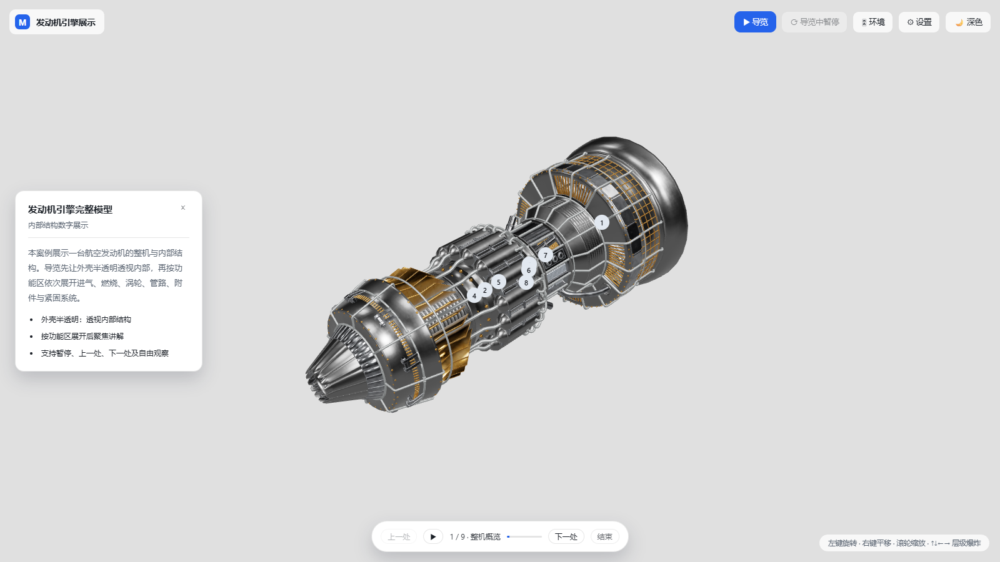

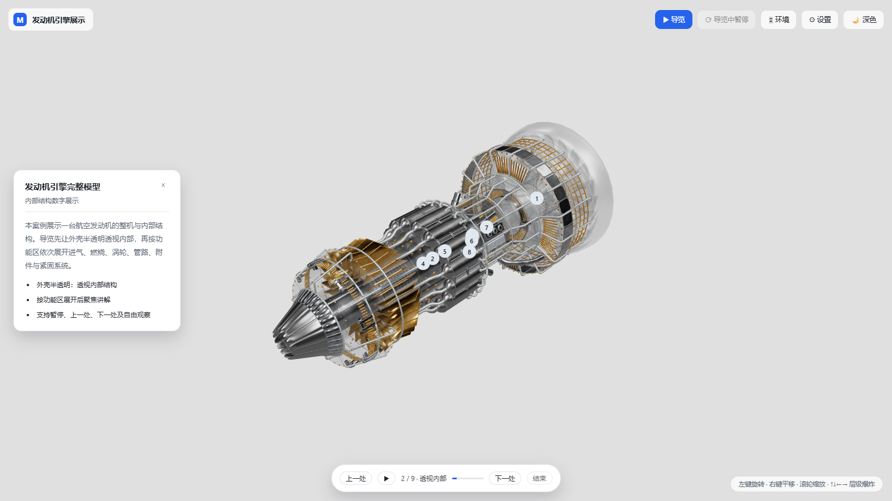

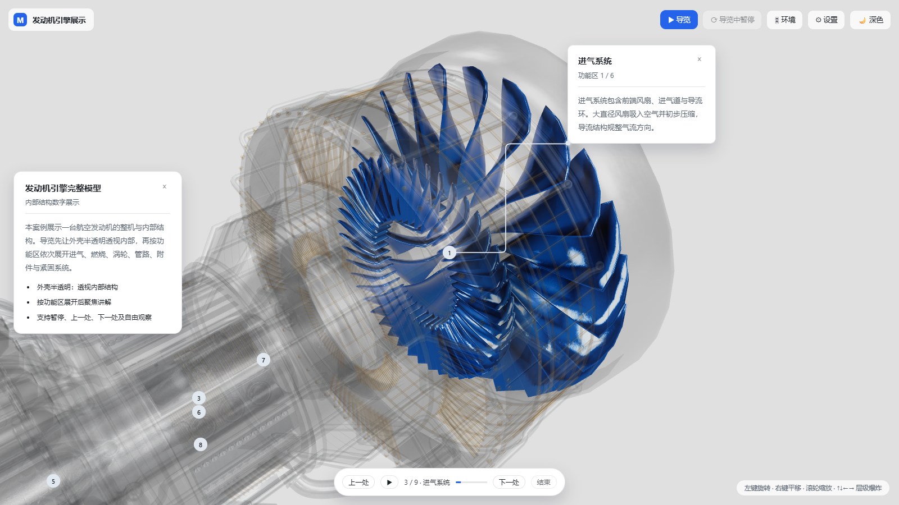

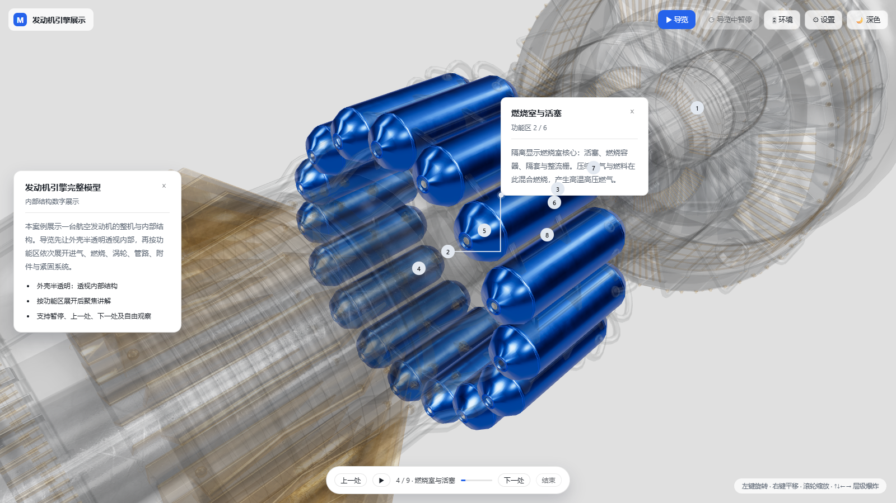

| 步骤 | 配置 | 接收方看到什么 |
| --- | --- | --- |
| 看整体 | 全机镜头、常驻概览卡、可选开场讲解与背景音乐 | 了解设备用途与主要构成 |
| 看部件 | 按标准六动作流程，当前目标恢复原材质、运镜、步骤卡与讲解 | 看清讲解对象，上一段说明不叠加 |
| 看外壳内 | 点击绑定外壳父节点的热点，临时半透明并聚焦 | 保留外形参照，同时查看内部机构 |
| 看装配 | 选择组件分支按层级爆炸 | 分辨装配关系，不把它当作真实运动轨迹 |
| 看细节 | 点击关键零件的热点，显示引线说明或尺寸标注 | 主动查看零件信息，避免重复绘制标记 |
| 回整体 | 恢复模型显示状态，另配运镜与隐藏卡片 / 标注 | 模型回到常规显示，讲解界面按配置收起 |

> 演示前请用**发布链接**检查每一步，不要仅以编辑器试播代替发布端验收。

### 发布安全边界（如实告知）

- 分享链接含随机令牌，**令牌本身就是访问凭证**：持有链接且能连接服务器的人可免登录查看，发布前应确认该内容允许分享；
- 未发布项目仍按用户归属隔离，普通用户不能因为知道项目名称就读取私有内容；
- **当前不提供分享密码、自动到期、逐个访客授权或 DRM 防提取承诺**；浏览器收到的模型资源可能被保存，**不能声称"只读所以不能下载"**；
- 撤回可阻止后续服务端访问，但**不能删除接收方已下载或已打开的内容**；
- 内网发布只在可达网络内访问，**不自动开放公网**；公网展示需另行配置域名、HTTPS、访问策略与防护；
- 离线部署采用本地图片 / 视频；云端 AI 或外部媒体地址会改变"数据不出域"的边界。

---

## 与传统处理方式的对比

| 维度      | 传统方式（CAD 软件逐个导出 + 脚本手工处理） | LiteModelProcess·AI                |
| ------- | ------------------------- | ------------------------------- |
| 上手门槛    | 需掌握多款 CAD / DCC 软件与命令行脚本  | 网页上传即用，全程浏览器操作，无需安装软件           |
| 大模型渲染   | 通用查看器打开大装配卡顿甚至崩溃          | 唯一几何批处理 + BVH 加速，千万级三角面流畅交互     |
| 转换质量    | 各软件导出口径不一，单位 / 朝向易错       | 统一米制 Y+ 口径，三档质量可选，自动模式明确返回推断警告  |
| 大装配性能   | 手工减面、合并费时费力，易破坏层级         | 自动实例化 + 唯一几何批处理，保留完整场景树         |
| 轻量化编辑   | 减面、去小件、修孔、改轴心需多工具串联       | 右键菜单一站式完成，全部支持撤销 / 重做           |
| 复用与协作   | 每人各转各的，重复劳动               | 相同模型转换缓存秒级复用，账号与项目隔离协作          |
| 部署与数据安全 | 工具分散，难以统一管控               | 离线包私有化部署，支持国产化系统，数据不出内网，离线机器码授权 |

## 部署要求（一台服务器带 10 人同时使用）

渲染在浏览器端完成，**服务器无需独立显卡**；重型转换在独立子进程中并行执行，一台服务器即可支撑 10 人同时在线、多人同时提交转换：

| 档位 | CPU | 内存 | 磁盘 | 操作系统 | 适用 |
| --- | --- | --- | --- | --- | --- |
| 最低 | 16 核 32 线程 | 32 GB | 500 GB SSD | Windows / Linux / 国产化系统 | 10 人同时在线浏览 / 编辑 / 导出，2 路转换并行 |
| 推荐 | 32 核 64 线程 | 64 GB–128 GB | 1 TB NVMe SSD | Windows / Linux / 国产化系统 | 含 500 万三角面级大型装配，4–8 路转换并行，10 人同时提交免等待 |

> 使用者电脑用 64 位 Chrome / Edge 浏览器即可；千万级三角面超大模型建议客户端配备独立显卡。并行转换路数随内存档位配置（32 GB → 2 路、64 GB → 4 路、128 GB → 6–8 路）。**10 人同时在线为初始规划值，需按客户模型与服务规格压测。** 需要更高转换吞吐时，可在内网加装**多台转换节点横向扩展**（节点 16 核 / 32 GB 起、无需单独授权，加节点即加吞吐、前端与使用者零感知），完整方案见 [部署与运维（Wiki）](https://github.com/starTechnology1994/LiteModel-AI/wiki/部署与运维)。

## 使用文档

完整使用文档见 GitHub Wiki：

- [使用手册（Wiki 首页）](https://github.com/starTechnology1994/LiteModel-AI/wiki)
- [快速开始](https://github.com/starTechnology1994/LiteModel-AI/wiki/快速开始)
- [功能介绍](https://github.com/starTechnology1994/LiteModel-AI/wiki/功能介绍)
- [设备展示与讲解](https://github.com/starTechnology1994/LiteModel-AI/wiki/设备展示与讲解)
- [AI 助手](https://github.com/starTechnology1994/LiteModel-AI/wiki/AI助手)
- [部署与运维](https://github.com/starTechnology1994/LiteModel-AI/wiki/部署与运维)
- [多机转换集群](https://github.com/starTechnology1994/LiteModel-AI/wiki/多机转换集群)
- [授权与购买](https://github.com/starTechnology1994/LiteModel-AI/wiki/商业授权)

## 联系我们

- 商务合作 / 授权咨询 / 技术支持：**<startechnology1994@163.com>**
- 企业微信：<https://work.weixin.qq.com/ca/cawcdef9a4d05fef8c>
- Bilibili 视频教程：<https://space.bilibili.com/3546688536971381>
- 项目仓库：<https://github.com/starTechnology1994/LiteModel-AI>